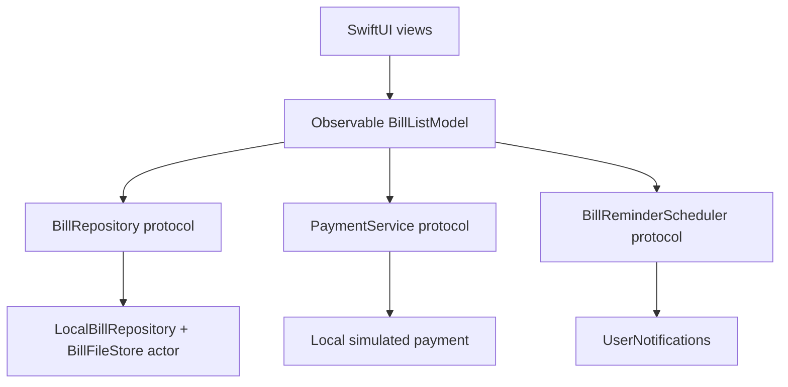

# BillFlow

A SwiftUI portfolio app for tracking bills, simulating payments, and scheduling local reminders. Built in small, testable steps to demonstrate async/await, Observation, protocol-based dependencies, local persistence, and UserNotifications.

All payments are local simulations. No banking integration or real charges.

## Run locally

Requires Xcode 27.1, an installed iOS 27+ simulator runtime, and Python 3 for the command-line test script. The deployment target is iOS 27.0. No third-party app dependencies or signing credentials are needed for simulator builds.

1. Open `BillFlow.xcodeproj`.
2. Select the shared **BillFlow** scheme and an iOS 27+ simulator.
3. Run with Cmd+R; run the unit suite with Cmd+U.

Or build and test from the repo root:

```sh
bash scripts/test.sh
```

The script chooses an available iPhone simulator running iOS 27 or later. Set `SIMULATOR_ID` to use a specific device. Test results are saved under `.build/`; open the `.xcresult` bundle in Xcode. Existing result bundles are preserved.

## What to try

- Inspect Electricity (overdue), Internet (upcoming), and Rent (paid) on a fresh install.
- Tap **Pay (demo)**. Progress is shown while the simulation runs; Paid appears after saving succeeds. Relaunch to verify persistence.
- Tap **Remind me…** on an unpaid bill, choose a future date/time, then schedule. Permission is requested only then. Background the app to check delivery.
- Use the empty, loading-error, payment-failure, and large-text previews in Xcode. Preview dependencies are in memory and do not touch app storage or system notifications.

Uninstalling the simulator app removes its saved bills and provides a fresh demo.

## Design



- **Domain:** Foundation value types with stable IDs, integer USD cents, Codable data, and calendar-based overdue rules.
- **Presentation:** main-actor observable state; enums describe loading and payment outcomes. Views render state and send actions.
- **Storage:** JSON in Application Support/BillFlow/bills.json. A file-store actor serializes disk access; atomic writes avoid partial files. Only a missing file triggers seeding. Empty and corrupt files are not reseeded.
- **Payments:** one operation at a time. The model simulates, saves, then publishes Paid. Failure preserves the visible unpaid bill.
- **Reminders:** one pending request per bill ID; rescheduling replaces it. Saved payments cancel that bill's notifications.

These are folder boundaries in one app target, not separate Swift packages. Packages can be extracted if reuse or build isolation warrants it.

## Tests and CI

The 27 unit tests cover domain rules, loading and retry, persistence, payment sequencing/failure, and reminder permission/scheduling behavior. Storage tests use temporary folders; model tests use injected stubs.

The GitHub Actions workflow builds and runs the same script on feature-branch pushes and pull requests to main. It selects Xcode 27.1 on the `xcode-27` runner and uploads `.xcresult` diagnostics even after a test failure. No release signing or deployment occurs. Hosted execution is unverified until this branch is pushed and the workflow runs.

The shared scheme deliberately runs unit tests only. `BillFlowUITests` still contains Xcode starter templates; it is not evidence of UI coverage. Permission prompts, notification delivery, VoiceOver and visual behavior require the [manual checks](docs/VALIDATION.md).

## Scope and tradeoffs

This demo has no bill editor, recurring-bill engine, remote backend, authentication, or real payment gateway. JSON has no migration or multi-process transaction support. A real payment system would need durable receipts, idempotency and reconciliation when a charge succeeds but local saving fails. Reminder delivery depends on OS settings; foreground banners and a persistent list of scheduled reminders are not implemented.

## Learning and review

See the [step-by-step learning guide](docs/LEARNING.md) for implementation order and explanation checkpoints, and the [validation checklist](docs/VALIDATION.md) for remaining manual checks.

Work is committed on feature branches created from main. Changes merge to main only after we agree they are stable. Pushing and opening a pull request are separate requested actions.
